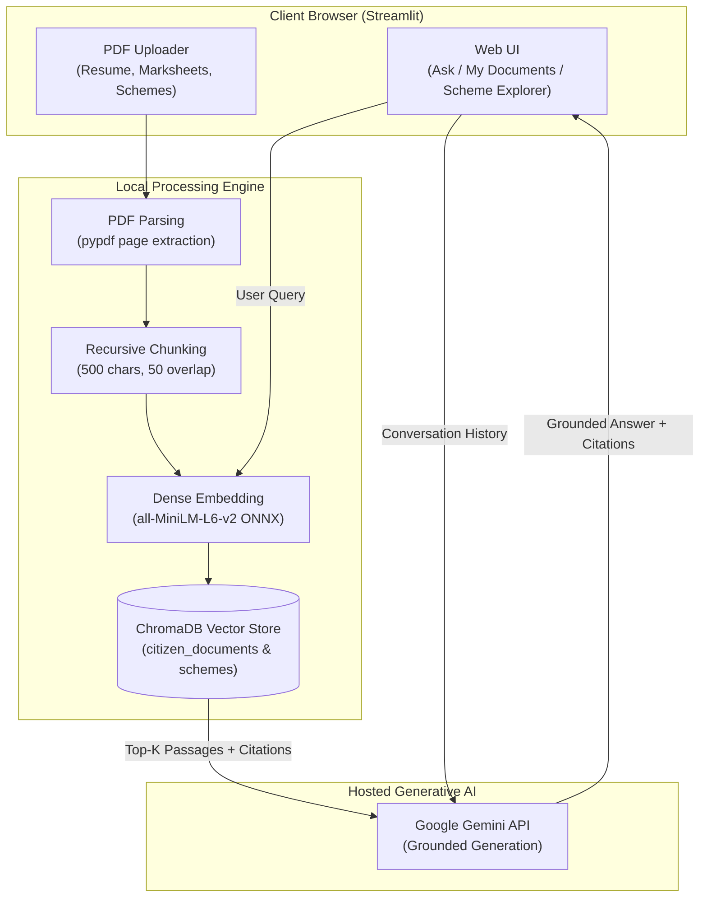

# 🏛️ AI Citizen Assistant

[](https://www.python.org/)
[](https://streamlit.io/)
[](https://www.trychroma.com/)
[](https://aistudio.google.com/)
[](https://opensource.org/licenses/MIT)

An intelligent, grounded Retrieval-Augmented Generation (RAG) assistant designed to help citizens navigate government welfare schemes, understand scholarship guidelines, and analyze their personal credentials with page-level citations.

---

## 🌟 Key Features

- **🔎 Grounded Scheme & Document Q&A:** Ask questions in English or Hindi (e.g., *"What documents are required for post matric scholarship?"* or *"मुझे किसानों के लिए योजनाएँ बताइए"*). Answers are strictly grounded in retrieved evidence with exact file and page citations.
- **📄 Automated Scheme Document Comparison:** Cross-references the citizen's uploaded credentials against scheme requirements, explicitly categorizing which required documents are **Available** (with source citations) and which are **Missing**.
- **📑 7-Section Personal Profile Intelligence:** The *"Analyze My Documents"* workflow automatically extracts personal details, educational background, skills, certifications, projects, achievements, and important validity dates from uploaded PDFs (resumes, marksheets, certificates).
- **🔎 Bilingual Scheme Explorer:** Interactive database browser supporting category filtering, level filtering (Central / State), keyword search, and language toggle (English / हिंदी).
- **🔒 Privacy-Preserving Architecture:** Text extraction, chunking, and vector embedding run 100% locally. Only retrieved relevant passages and questions are passed to the language model.

---

## 🏗️ System Architecture



---

## 📁 Repository Structure

```text
ai-citizen-assistant/
│
├── app.py                  # Streamlit web application & frontend interface
├── core.py                 # Core RAG engine (embeddings, ChromaDB, prompts, Gemini LLM)
├── schemes.csv             # Bilingual government schemes dataset (EN & HI)
├── requirements.txt        # Python package dependencies
├── .env.example            # Environment variables template
├── .gitignore              # Files ignored by git
├── README.md               # Project documentation
│
└── .streamlit/
    └── config.toml         # Streamlit UI theme and server settings
```

---

## 🚀 Quickstart Guide

### 1. Prerequisites
- **Python 3.10, 3.11, or 3.12** installed.
- A **Gemini API Key** from [Google AI Studio](https://aistudio.google.com) (free tier available).

### 2. Clone the Repository
```bash
git clone https://github.com/your-username/ai-citizen-assistant.git
cd ai-citizen-assistant
```

### 3. Create a Virtual Environment (Recommended)
```bash
# Windows
python -m venv venv
venv\Scripts\activate

# macOS / Linux
python3 -m venv venv
source venv/bin/activate
```

### 4. Install Dependencies
```bash
pip install -r requirements.txt
```

### 5. Configure API Key
Create a `.env` file in the project root:
```bash
# Windows (PowerShell)
Copy-Item .env.example .env

# macOS / Linux
cp .env.example .env
```

Open `.env` and add your Gemini API key:
```env
GEMINI_API_KEY=your_actual_gemini_api_key_here
```
*(Alternatively, you can paste the key directly into the sidebar input field in the web UI).*

### 6. Run the Application
```bash
streamlit run app.py
```
Open your browser at **http://localhost:8501** (or the port specified in terminal).

---

## 💡 How to Use

1. **💬 Ask Tab:**
   - Click one of the sample prompt buttons or type any question in the chat input at the bottom.
   - Use the toggle in the sidebar to enable/disable searching the government schemes database.
   - Expand the **📎 Sources used for the last answer** card to view the exact text, parent document, page number, and similarity score.

2. **📄 My Documents Tab:**
   - Upload text-based PDFs (e.g., marksheets, certificates, CV) via the sidebar.
   - Click **🔍 Analyze my documents** to produce a structured, clean 7-section credential summary.
   - Export or download the generated profile using the **⬇️ Download summary** button.

3. **🔎 Scheme Explorer Tab:**
   - Filter government initiatives by category (Agriculture, Education, Health, Housing, etc.) and level (Central / State).
   - Switch between **EN** and **हिंदी** to explore scheme guidelines, benefits, eligibility criteria, application process, and mandatory documents.
   - Click **Ask the assistant about this scheme** to immediately initiate a focused chat query.

---

## ⚙️ Technical Specifications

| Parameter | Specification |
| :--- | :--- |
| **Frontend Framework** | Streamlit |
| **PDF Extraction** | `pypdf` (page-by-page text layer extraction) |
| **Text Chunking** | `RecursiveCharacterTextSplitter` (chunk size: 500, overlap: 50) |
| **Embedding Model** | `all-MiniLM-L6-v2` (384-dimensional dense vectors, local ONNX) |
| **Vector Database** | ChromaDB with cosine similarity space (`hnsw:space: cosine`) |
| **Retrieval Depth** | Top $k \le 20$ ranked passages per query |
| **Generative LLM** | Google Gemini (`gemini-3.5-flash-lite` / `gemini-3.8-flash`) via `google-genai` SDK |
| **Session Isolation** | In-memory index recreation per upload session |

---

## 📜 Research & Citation
If you use this system or architecture in your academic work, please cite:

```bibtex
@article{ai_citizen_assistant_2026,
  title={AI Citizen Assistant: Grounded Retrieval-Augmented Generation for Government Schemes and Personal Document Intelligence},
  author={AI Citizen Assistant Research Team},
  year={2026}
}
```

---

## 📄 License
This project is licensed under the [MIT License](LICENSE).
